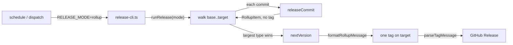
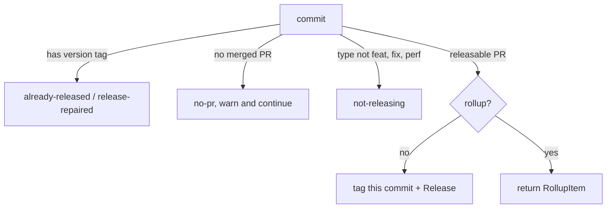

# Nightly rollup releases — a release-kit learning walkthrough

<!-- study-provenance: sources=src/release.ts,src/release-cli.ts,src/conventional.ts,src/read-releases.ts,.github/workflows/release.yml commit=624743c date=2026-10-29 -->

This guide teaches how `mode: rollup` turns a day of merged PRs into one version tag and one GitHub Release, and explains *why* each piece is shaped the way
it is by contrasting it with the naive alternative.

> Mental model up front: in rollup mode the release engine does the same walk it always did — every first-parent commit since the last version tag, oldest
> first — but a releasable PR no longer gets tagged on the way past. It hands back a small *item* instead. At the end the engine cuts **one** tag on the
> newest commit, bumped by the biggest change among the items, whose message lists every item in a format both old and new readers can parse.

> **Read it in a browser:** [`nightly-rollup-releases.html`](./nightly-rollup-releases.html) — this whole guide as one page, with the diagrams drawn and
> every cross-reference as an in-page jump. It is **generated** from this markdown file by [`tools/build.mjs`](./tools/build.mjs), so edit the markdown and
> re-run `node docs/guides/study/nightly-rollup-releases/tools/build.mjs`; never edit the `.html` by hand.

> Baseline: written against release-kit at commit `624743c` (2026-10-29), shortly after the rollup feature landed in #13.



---

## 1. Per-PR vs rollup: one opt-in switch

**What it does.** The reusable workflow gained a single input, `mode`, which defaults to the old behaviour:

```yaml
# .github/workflows/release.yml:25-28
      mode:
        description: per-pr tags each releasable PR; rollup cuts one tag for every releasable PR in the range (README §Adopting rollup releases).
        type: string
        default: per-pr
```

In `per-pr` mode, each push of a `feat`, `fix` or `perf` PR to `main` wakes the workflow and cuts a version for that PR alone. In `rollup` mode, the workflow
runs on a timer and cuts one version for everything merged since the last tag.

**Why it exists.** Ten releasable merges in a day are ten versions in per-PR mode, and every downstream consumer — the repos `bump-consumers.yml` opens
`chore(deps): bump` PRs against — churns once per version. Rollup turns that day into one version with grouped notes.

**The bad alternative.** Keep per-PR tagging and let consumers skip most versions. That hides the noise rather than removing it: the tags, the Releases and
the bump PRs still get made.

**Trade-offs accepted.** A fix now waits for the next scheduled run unless someone fires a manual dispatch. And the default stays `per-pr`, so, in the
README's words, a caller that sets nothing sees no difference (`README.md:151`).

## 2. The trigger: a mode switch that refuses typos

**What it does.** The caller swaps its `push` trigger for a `schedule` (for example `cron: '0 2 * * *'`) plus `workflow_dispatch`, and passes `mode: rollup`
(`README.md:153-155`). The workflow forwards the input as `RELEASE_MODE` (`release.yml:59`), and the CLI validates it:

```ts
// src/release-cli.ts:107-112
const modeEnv = process.env.RELEASE_MODE;
if (modeEnv !== undefined && modeEnv !== 'per-pr' && modeEnv !== 'rollup') throw new Error(`RELEASE_MODE must be per-pr or rollup; got ${JSON.stringify(modeEnv)}`);
const mode = modeEnv ?? 'per-pr';
// Only a manual dispatch should hear "a newer release exists"; a re-run of a superseded push run must end green.
// A scheduled run skips too: nobody is watching it, and a newer tag only means a dispatch got there first.
const onNewer = process.env.GITHUB_EVENT_NAME === 'workflow_dispatch' ? 'reject' : 'skip';
```

**Why a strict check.** The tempting version is "anything that isn't `rollup` means `per-pr`". Then a typo such as `mode: rolup` silently tags every PR one
by one — the exact thing the caller was opting out of — and nobody notices until the tags pile up. Failing fast costs one red run; silently falling back
costs a stack of unwanted versions. Only an *unset* variable defaults, which keeps callers older than the input working.

**Why `onNewer` depends on the event.** When a later commit already carries a version tag, nothing is tagged either way, because versions are never assigned
out of order. A dispatch has a person watching, so it fails with `a newer release exists: <tag>`. A scheduled run has nobody watching, and the likeliest cause
is a dispatch that got there first, so it logs the same line and ends green (`README.md:157-158`).

**Why `DEFAULT_BRANCH` has a fallback.** A `schedule` event carries no `repository` payload, so `github.event.repository.default_branch` is empty there. The
workflow falls back to `github.ref_name` (`release.yml:62`), which is the default branch because schedules only ever run on it. The engine needs that name to
refuse a target that is not on `origin/<default branch>`.

**Overlapping runs.** The caller keeps the `concurrency` block from *Adopting releases*, which stops a slow scheduled run and a manual dispatch from tagging at
the same time (`README.md:154-155`).

## 3. The engine: one walk, two endings

**What it does.** `runRelease` (`src/release.ts:136-180`) is shared by both modes, and its front half did not change: refuse a target that is not on trunk,
refuse to release out of order (`newerRelease`), find the base tag with `git describe`, and list the `base..target` first-parent commits oldest first — with
the base commit itself added at the front, so a baseline whose Release is missing still gets repaired.

Each commit then goes through `releaseCommit`, whose first three steps are identical in both modes:



The one fork is a single line:

```ts
// src/release.ts:110-112
const type = check.type as ReleaseType;
const breaking = isBreaking(check, pull.body);
if (rollup) return { pr: pull.number, title: pull.title, type, scope: check.scope, breaking, notes: releaseNotes(pull.body) };
```

In per-PR mode the code below this line tags and releases the commit. In rollup mode the commit just reports what it would have released.

**The bad alternative.** A separate rollup engine. It would have to re-implement every safety rule — not on trunk, newer release exists, no PR means skip and
carry on, a tag whose Release is missing only needs the Release — and two copies of release logic drift apart, which in release code means wrong versions.

**What sharing buys.** Rollup inherits idempotence for free. After a successful rollup, a re-run describes the rollup tag as its new base, the range after it
is empty, and the only commit left to look at is already released.

**Trade-off accepted.** `releaseCommit` now returns `Outcome | RollupItem`, a union that `runRelease` tells apart with `'pr' in result`
(`release.ts:168` and `release.ts:179`). A slightly awkward return type, kept so that there is only one walk.

## 4. Picking the version: biggest change wins, once

```ts
// src/release.ts:171-177  (compacted here)
if (items.length) {
  const type = RELEASE_TYPES.find((t) => items.some((i) => i.type === t)) as ReleaseType;
  version = nextVersion(base, type, items.some((i) => i.breaking));
  const tag = `v${version}`;
  await pushTag(cwd, tag, target, formatRollupMessage(items));
  await createRelease(cwd, github, tag);
}
```

**What it does.** `RELEASE_TYPES` is `['feat', 'fix', 'perf']` (`src/conventional.ts:32`), listed in rank order, so `.find` returns the largest type any item
has. One breaking item makes the whole release breaking. `nextVersion` (`conventional.ts:49-55`) then bumps once from the base:

| Items since `v1.4.2` | Rollup version |
|---|---|
| `fix`, `perf` | `v1.4.3` |
| `fix`, `feat`, `perf` | `v1.5.0` |
| any of the above with one breaking PR | `v2.0.0` |
| only `docs`, `chore`, or nothing | no tag, no Release, run ends green |

Below 1.0.0 a breaking change bumps the minor instead of the major, exactly as in per-PR mode.

**The bad alternative.** Bump once per item (1.4.2 → 1.5.0 → 1.5.1 → 1.5.2) and publish only the last. That produces version numbers that were never
released, and makes the version count PRs rather than describe the change. SemVer means one release, sized by its largest change, and that is what this does.

**Trade-off accepted.** The tag lands on the **target** — the newest commit — and the PR commits between it and the base get no tag of their own. You cannot
install "just after #21"; you get the nightly snapshot.

## 5. The tag message: one tag, many PRs, old readers still parse it

The annotated tag message is the source of truth: the GitHub Release and every releases reader are rebuilt from it. `formatRollupMessage`
(`conventional.ts:136-157`) writes it. A constructed example — #21 is `feat(ui)` with notes, #22 is a plain `fix` with none:

```text
// example (constructed)
Ui — 2 changes

### Ui

You can filter releases by type. (#21)

### Other

tag push retries (#22)

Release-Type: feat
Release-Items: 21:feat:ui, ~22:fix
```

The trailer block is built last:

```ts
// src/conventional.ts:152-156
  // RELEASE_TYPES is in rank order, so the first type any item has is the highest; breaking only adds its own trailer.
  const trailers = [`Release-Type: ${RELEASE_TYPES.find((t) => items.some((i) => i.type === t))}`];
  if (items.some((i) => i.breaking)) trailers.push('Release-Breaking: true');
  trailers.push(`Release-Items: ${entries.join(', ')}`);
  return `${subject}\n\n${body.join('\n\n')}\n\n${trailers.join('\n')}\n`;
```

Why each piece is there:

- **Grouped by scope, `Other` last.** The body is what a person reads in the GitHub Release, so it is organised the way a reader scans: by area.
- **The `Release-Items` trailer is the machine index.** Each entry is PR number, type, `!` when breaking, and scope; a leading `~` means the item had no notes
  and its text is the title with the `feat(ui): ` prefix stripped. `parseRollupItems` (`conventional.ts:166-196`) walks the list against the body to split it
  back into per-PR items, ending each item at the first line that ends in its own ` (#N)` marker.
- **Own markers are scrubbed from the notes.** Because the parser ends an item at its marker, a stray `(#21)` inside #21's own notes would cut the item
  short. `withoutOwnMarker` (`conventional.ts:126-129`) removes it from every line before the formatter appends the real one.
- **No `Release-PR` or `Release-Scope` trailer, on purpose.** A reader from v1.3.0 or earlier does not know `Release-Items`, so it sees a single release whose
  notes are the grouped body. The new format degrades into something an old reader shows sensibly, instead of something it misparses.
- **`--cleanup=verbatim` when tagging** (`release.ts:74`). By default git strips lines starting with `#` from a tag message as comments, which would delete
  every `###` heading.

**The bad alternative.** A JSON blob in the tag message. Machine-readable, but unreadable in the GitHub Release and in `git show`, and an old reader would
print raw JSON as the release notes.

## 6. Where the notes come from, and the `None` opt-out

Each item's notes are its PR body's `## What's new` section, read by `extractWhatsNew` (`conventional.ts:61-70`) with HTML comments stripped first, so the
template's hint never leaks into a release. `releaseNotes` then drops an explicit opt-out:

```ts
// src/conventional.ts:72-80  (compacted here)
export function isNoneOptOut(notes: string): boolean {
  return /^None(\s+[—-]\s+.+)?$/i.test(notes.trim());
}
export function releaseNotes(body: string | null): string {
  const notes = extractWhatsNew(body);
  return isNoneOptOut(notes) ? '' : notes;
}
```

A PR with no notes still appears in the rollup: its entry falls back to the title (that is the `~` in `Release-Items`).

**The optional gate.** With `require-notes: true` on the `ci-node.yml` call, the existing `ci / pr-title` check also fails a `feat`, `fix` or `perf` PR whose
`## What's new` is empty or missing, via `checkNotes` (`conventional.ts:86`). Writing `None` — optionally `None — internal only` — passes the check and keeps
the word out of the tag and the Release (`README.md:137-145`).

**Why opt-in, and why `None` instead of "just leave it empty".** An empty section is ambiguous: forgotten, or deliberately silent? `None` makes silence an
explicit choice, which is what lets the check fail the forgotten case without nagging the deliberate one. It is off by default so an existing caller sees no
new red checks.

## 7. Reading it back

`readReleasesResult` (`src/read-releases.ts`) now returns `items` on every release, built from `parseTagMessage`'s new `items` field
(`conventional.ts:202`): empty for the baseline tag, one item for a per-PR tag, one per PR for a rollup. Each item carries a PR `url` when the origin is
GitHub. A UI can therefore show a rollup as a list of changes with links rather than one block of text, while per-PR releases look like a one-item list.

## 8. FAQ: "How does the new release work?"

This was the question that started the session. Short answer: a scheduled (or manually dispatched) run of `release.yml` with `mode: rollup` walks every
first-parent commit on `main` since the newest version tag. Commits whose merged PR is `feat`, `fix` or `perf` each contribute an item — type, scope,
breaking flag, `## What's new` notes — instead of getting their own tag. If any items were collected, the run cuts one annotated tag on the newest commit,
bumped by the largest item (breaking beats `feat` beats `fix`/`perf`), with a message grouping the items by scope and a `Release-Items` trailer indexing them,
then creates the GitHub Release from that message. If nothing releasable merged, it does nothing and stays green. Everything else — the trunk check, the
out-of-order guard, skipping commits with no PR, repairing a missing Release — is the per-PR engine, unchanged.

---

**Relevant files**

- `.github/workflows/release.yml` — the reusable workflow; the `mode` input and the `DEFAULT_BRANCH` fallback for scheduled runs
- `src/release-cli.ts` — reads `RELEASE_MODE` strictly and picks `onNewer` from the event name
- `src/release.ts` — `runRelease` and `releaseCommit`: the shared walk, the rollup fork, the version pick and the single tag
- `src/conventional.ts` — `nextVersion`, `formatRollupMessage`, `parseTagMessage` / `parseRollupItems`, `releaseNotes` and `checkNotes`
- `src/read-releases.ts` — exposes each release's `items` with PR links to readers such as a releases UI
- `scripts/pr-title.mjs` — the PR-title check, which runs the opt-in notes rule when `REQUIRE_NOTES` is `true`
- `README.md` — *Adopting rollup releases* and *Adopting the notes check*, the caller-facing contract
